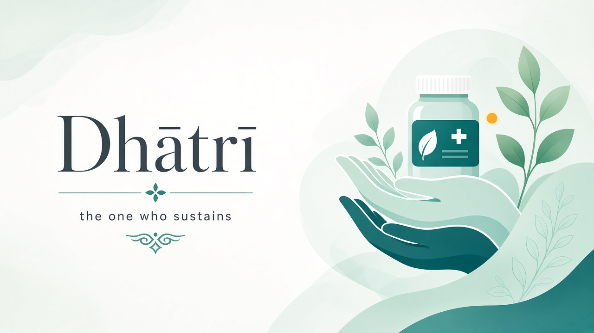
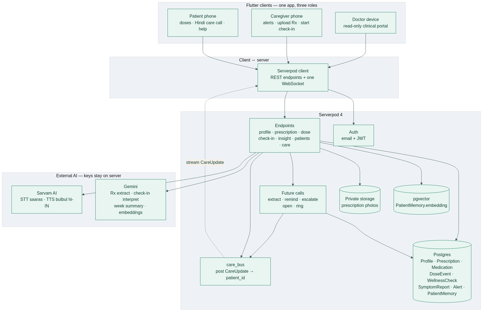

<p align="center">
  
</p>

<p align="center">
  <strong>An AI care companion for Indian elder care</strong><br/>
  Prescription → schedule → adherence → Hindi voice check-in → caregiver alert → doctor insight
</p>

<p align="center">
  
  
  
  
</p>

<p align="center">
  
  
  
  
  
</p>

---

## The problem

In India, millions of elderly patients manage several chronic medicines at home while their children live in other cities. A handwritten prescription becomes a vague daily routine. When a dose is missed at 8 PM, nobody knows until the next family call. When a parent says *“I feel weak,”* it vanishes into conversation instead of becoming clinical context.

English-first reminder apps assume UI literacy elders may not have, stop at the beep, and forget every previous check-in. We built **Dhātrī** (Sanskrit: *the one who sustains*) to close that loop — with voice in Hindi, live caregiver escalation, and memory that lasts across days.

## What it does

One Flutter app. Three roles. One Serverpod backend.

**Patient** — large type, high contrast, next-dose card, one-tap Taken, in-app Hindi care calls.  
**Caregiver** — prescription photo → AI draft → human confirm, live missed-dose alerts, triage, trigger check-ins.  
**Doctor** — read-only dashboard: adherence, repeated symptoms, factual weekly insight.

```text
Prescription photo
    → Gemini draft + human confirm
    → Serverpod schedules dose events
    → Reminder → Taken / Missed
    → Live caregiver alert (WebSocket)
    → Hindi care call (Sarvam STT/TTS)
    → Patient Memory (pgvector)
    → Doctor sees the pattern
```

AI assists. Humans stay in control. Dhātrī does not diagnose — it notices patterns and routes them to people.

## Brand & UI

Calm clinical teal, not tech-purple. Designed for WCAG AA contrast; every status pairs color with icon and label.

| Token | Hex | Use |
|-------|-----|-----|
| Primary | `#0A686D` | Brand, primary actions, navigation |
| Primary dark | `#06474B` | Pressed / emphasis |
| Primary light | `#E6F3F3` | Soft fills, chips |
| Background | `#F7F9FA` | App canvas |
| Success | `#15803D` | Taken / healthy |
| Warning | `#B45309` | Attention / review |
| Error | `#B91C1C` | Missed / escalate |
| Call green | `#059669` | Answer care call |

Patient screens stay low-density (one obvious next action). Caregiver screens triage. Doctor screens show trends. Details live in [`Dhatri_UI_UX_Design_Guide.md`](Dhatri_UI_UX_Design_Guide.md) and `dhatri_flutter/lib/core/theme/app_colors.dart`.

## Why Serverpod

Not a thin REST wrapper — the product maps onto Serverpod features:

- **Auth** — patient / caregiver / doctor (JWT + role on `Profile`)
- **PostgreSQL models** — prescriptions, doses, alerts, wellness (`.spy.yaml` → typed client)
- **Private file storage** — prescription photos
- **Future Calls** — remind at 8:00, escalate after grace (survive restarts)
- **Recurring tasks** — daily care calls
- **Streams** — live `CareUpdate` on `patient_{id}`
- **pgvector** — Patient Memory retrieval (“you mentioned weakness before…”)

**One rule:** mutate Postgres, then post a `CareUpdate`. That bus lights up the caregiver phone and rings the patient for a care call.

## Why Flutter

One codebase, three shells by `Profile.role`. Elder-accessible targets (≥ 48 dp), Hindi copy, dual-phone demos, and a voice call UI with waveform + quick-answer chips when STT is noisy. The generated Serverpod client keeps the UI on workflows, not hand-rolled DTOs.

## Regional voice (Hindi first)

Elders often speak Hindi, code-mixed with English medicine names (*“आज medicine ली?”*). English-first stacks mishear Indian accents.

- **STT** — Sarvam Saaras (`saaras:v3`), `hi-IN`
- **TTS** — Sarvam Bulbul (`bulbul:v3`), speaker `priya`
- **Conversation / Rx / embeddings** — Google Gemini
- **Fallback** — on-device Flutter TTS + Hindi answer chips

```text
Patient speaks Hindi
    → Sarvam Saaras
    → Gemini + Patient Memory
    → Hindi reply
    → Sarvam Bulbul
    → Patient hears Dhātrī
```

> **Dhātrī:** नमस्ते रमेश जी। आज आप कैसा महसूस कर रहे हैं?  
> **Patient:** थोड़ा कमजोर महसूस कर रहा हूं।  
> **Dhātrī (with memory):** recalls earlier weakness and asks if it is worse today.

## Architecture

<p align="center">
  
</p>

More diagrams (missed-dose alert, care-call pipeline, data model, CareUpdate bus): [`docs/DIAGRAMS.md`](docs/DIAGRAMS.md).

## Repository layout

```text
dhatri_server/     Serverpod backend — endpoints, future calls, Gemini, Sarvam, memory
dhatri_client/     Generated typed client (do not hand-edit)
dhatri_flutter/    Flutter multi-role app
docs/              Demo notes, diagrams, assets
ARCHITECTURE.md    What is actually built
PROJECT_DESCRIPTION.md   Submission writeup
```

## Quick start

Requires Flutter, Dart, and [Serverpod CLI](https://docs.serverpod.dev). From the repo root:

```bash
# Start server + Flutter (watches for changes)
serverpod start
```

Or run pieces separately:

```bash
cd dhatri_server && dart pub get
# Configure config/passwords.yaml (never commit secrets)
serverpod start

cd dhatri_flutter && flutter pub get && flutter run
```

Android builds need `speech_to_text` 7.5+ (no jcenter). Mic permission is requested for care calls.

See [`docs/DEMO.md`](docs/DEMO.md) for seeded demo accounts and the 2-minute video scene order. See [`docs/TEST_AND_DEBUG.md`](docs/TEST_AND_DEBUG.md) for testing.

Server package tests (embedded Postgres, no Docker):

```bash
cd dhatri_server && dart test
```

## Honest scope

Working end-to-end: auth + three roles, prescription → confirm → doses, reminders, missed-dose escalation, live caregiver alerts, Hindi care call with memory, doctor insight.

Care calls are **in-app** (not PSTN). Patient reminders assume the app is reachable (no FCM in this build). Deliberate cuts so the Serverpod-orchestrated loop stayed solid.

## One line

**Dhātrī turns a prescription into continuous elder care** — Flutter for accessible multi-role UX, Serverpod for auth, scheduling, realtime alerts, and patient memory, and Sarvam’s Hindi STT/TTS so people can speak in their own language.

---

<p align="center">
  <sub>Built for the Serverpod Hackathon · Palette from <code>AppColors</code> · Deep teal <code>#0A686D</code></sub>
</p>
